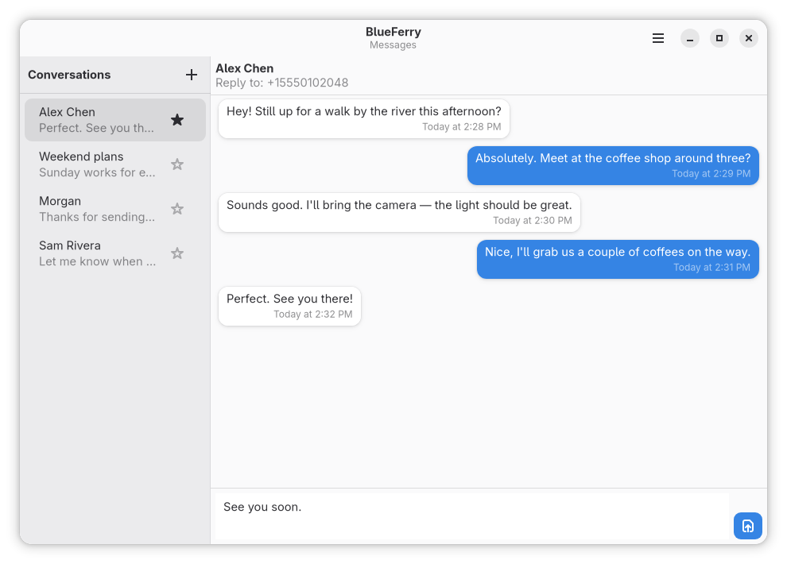
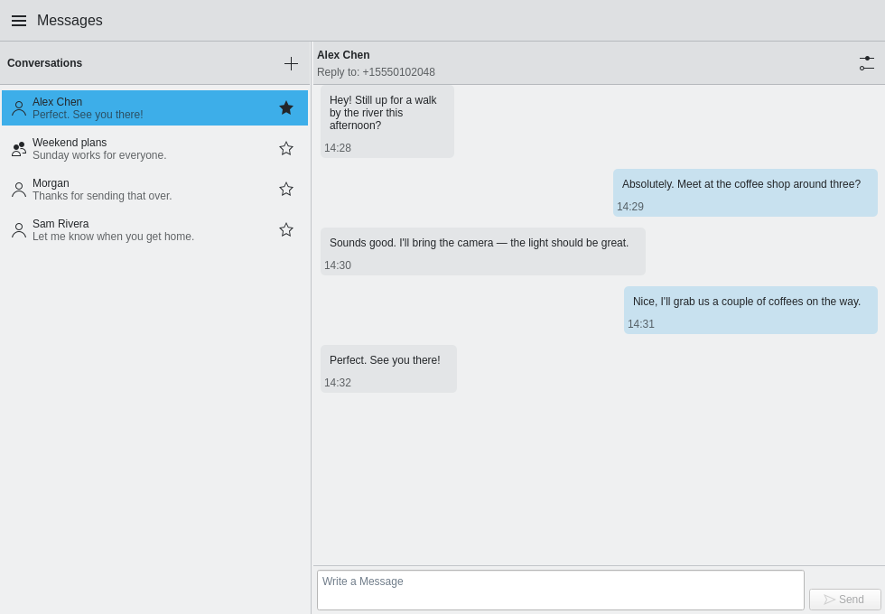
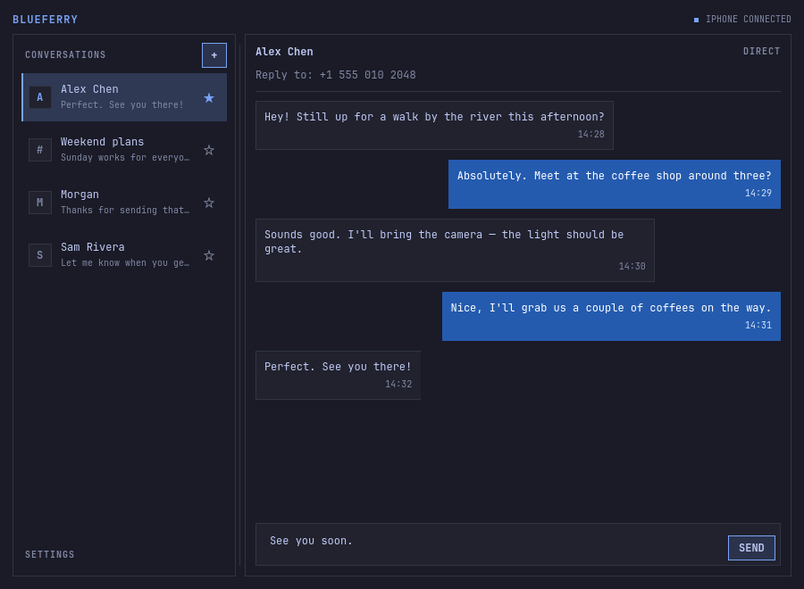
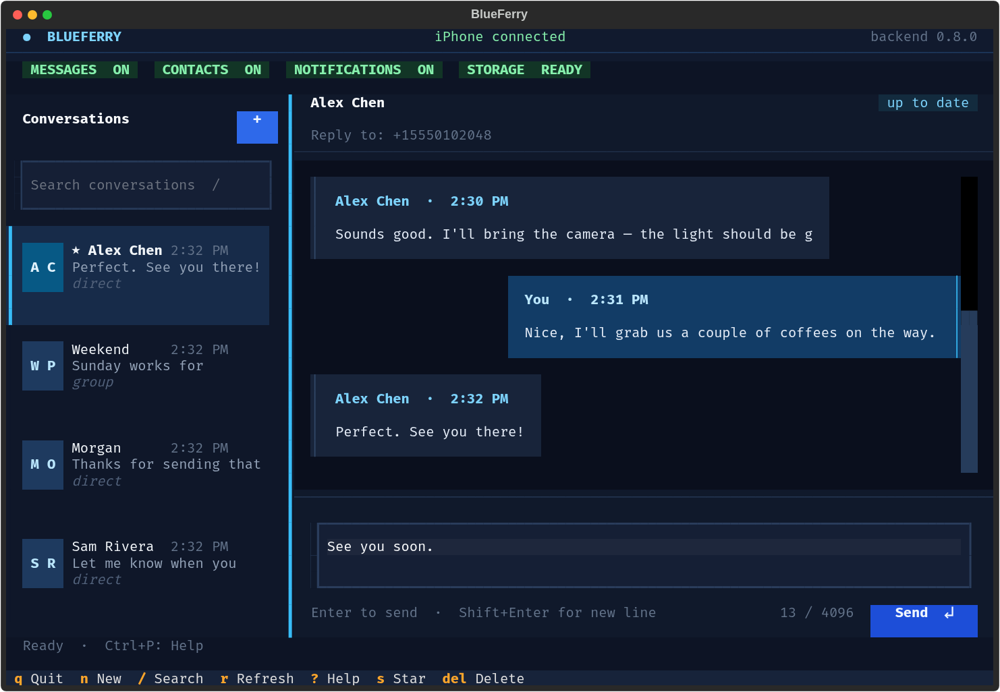

# Clients

Alle Clients sprechen mit demselben Hintergrunddienst. Du kannst also
zwischen ihnen wechseln oder mehrere gleichzeitig nutzen. Nachrichten,
Kontakte und Einstellungen sind überall dieselben.

Die Clients selbst sind derzeit auf Englisch.

## GTK (GNOME und ähnliche)

`blueferry-gtk` ist eine GTK4/libadwaita-App für GNOME, Cinnamon und ähnliche
Desktops.



Das Fenster ist eine Telefon-Übersicht. Eine Karte über den Reitern zeigt
Name und Verbindung des iPhones, Akku, Empfang und Netz sowie, was gerade
läuft (mit zurück, Wiedergabe/Pause und weiter sowie
[leiser und lauter](media-control.md) um die zuletzt vom iPhone
gemeldete Lautstärke). Ihr Knopf **Quick
Settings** enthält die Schalter für [den Ton](phone-audio.md) und die
[Abwesenheitssperre](proximity-lock.md). Ist etwas ausgeschaltet, nennt die
Karte die Einstellung, die es einschaltet. Die Reiter wechselt man
in der Kopfzeile, in einem schmalen Fenster unten:

- **Messages**: Unterhaltungen und der Chat.
- **Contacts**: die [Kontaktkarten](contacts.md) mit einem Suchfeld; eine
  Karte zeigt jede Nummer mit Bezeichnung, E-Mail- und Postadressen,
  Firma, Funktion und Foto, mit **Call** und **Message** (öffnet die
  Unterhaltung mit dieser Nummer oder eine neue Nachricht).
- **Calls**: laufende [Anrufe](calls.md) mit annehmen, halten/fortsetzen,
  auflegen, Tastentönen (0-9, `*`, `#`) für den aktiven Anruf sowie dem
  Ton-Schalter, ein Wählfeld, das auch deine
  Kontakte nach Namen durchsucht, und die [Anrufliste](call-history.md) nach Tagen
  gruppiert, mit All und Missed, Rückruf- und Nachrichtenknöpfen und
  **Refresh from iPhone**. Jeder Anruf fragt vorher nach.
- **Notifications**: die [letzten iPhone-Mitteilungen](notification-history.md)
  anderer Apps, mit einem Knopf zum Anheften an jedem Eintrag; angeheftete
  Einträge stehen oben, Einträge, die das iPhone entfernt hat oder die von
  [stummgeschalteten Apps](notification-mute.md) stammen, sind abgeblendet.
  Ist die Liste aus, sagt der Reiter warum und öffnet die Einstellung.
- **Photos**: die neuesten Fotos und Videos eines [Foto-Plugins](plugins.md),
  mit All, Photos und Videos; ein Klick lädt das Original und öffnet es,
  ein geöffnetes lässt sich in andere Apps ziehen.

**Plugins & Tools** auf der Karte klappt auf, was der KDE-Client unter
seinen Schaltern zeigt: **From Plugins** (was [Plugins](plugins.md)
anbieten, mit ihren Knöpfen, und **Send to…**; auf ein Geräte-Element
gezogene Dateien gehen an dieses Gerät) und **Tools** (Bildschirm spiegeln,
LocalSend, die Fotos des iPhones über USB). Der Bereich bleibt, wie du ihn
verlassen hast, und klappt von selbst auf, wenn ein Plugin etwas Neues
bringt, etwa eine laufende Übertragung.

Zieh Dateien aus der Dateiverwaltung irgendwo aufs Fenster, um sie über ein
Plugin mit **Send to…** wie LocalSend ans iPhone zu senden; siehe
[Dateien aufs Fenster ziehen](plugins.md#dateien-aufs-fenster-ziehen).

Die Lupe in der Kopfzeile, `Strg+K` oder `Strg+F` öffnet die
[Suche](search.md) über Unterhaltungen, Nachrichten, Kontakte und Anrufe.
Ein Treffer öffnet die Unterhaltung bei dieser Nachricht, die Kontaktkarte
oder den Anruf in der Anrufliste.

**Quick Reply from Message Popups** (Settings › Notifications › Content and
Actions, standardmäßig aus) lässt einen Klick auf ein Nachrichten-Popup statt
des Fensters ein kleines Feld oben in der Bildschirmmitte öffnen: die
letzten vier Nachrichten der Unterhaltung und ein Antwortfeld, in dem der
Cursor schon steht. Eingabe sendet, und das Feld schließt sich, sobald das
iPhone den Versand bestätigt. Esc oder ein Klick daneben schließt es; eine
schon abgeschickte Antwort geht trotzdem raus, und ein Fehler erscheint dann
als Desktop-Mitteilung. Ein leeres Feld schließt sich nach zwei Minuten von
selbst. Braucht eine Antwort eine Bestätigung, etwa in manchen Gruppen,
öffnet sich das Fenster mit dem schon getippten Text, ebenso mit **Open in
BlueFerry**. Über anderen Fenstern bleibt das Feld mit
[gtk4-layer-shell](https://github.com/wmww/gtk4-layer-shell) auf Compositors
mit dem Layer-Shell-Protokoll (zum Beispiel COSMIC, KDE Plasma, Sway und
Hyprland); ohne die Bibliothek oder unter GNOME ist es ein kleines normales
Fenster.

**Settings** (Hauptmenü, `Strg+,`) hat dieselben Kategorien wie der
KDE-Client, je eine Seite; die Umschaltleiste sitzt in der Kopfzeile, in
einem schmalen Fenster unten, und der Suchknopf findet jede Einstellung:

| Kategorie | Inhalt |
| --- | --- |
| Phone | Kopplung, Verbindungszustand mit **Reconnect**, **Run Diagnostics** (dieselben Prüfungen wie `blueferry doctor`; der Bericht öffnet sich in einem eigenen Dialog mit Kopierknopf), Kopplungsbericht, Kontaktabgleich, Kontaktfotos |
| Notifications | Welche Ereignisse Popups erzeugen, nur Kontakte, [stummgeschaltete Apps](notification-mute.md), Klickregeln, Mitteilungsinhalt, Aktionsknöpfe, Mitteilungen mit dem iPhone abgleichen, beim Wegklicken als gelesen markieren, letzte Mitteilungen behalten, Schnellantwort aus Nachrichten-Popups |
| Calls & Audio | Anrufe, Anrufliste, Akku-Warnung, [iPhone-Ton am Computer](phone-audio.md), Mediensteuerung |
| Network | Optionales [Bluetooth-Tethering](bluetooth-tethering.md) |
| Security | Einmalcodes, Abwesenheitssperre, lokale Daten und ihre Verschlüsselung, Verlauf löschen |
| Plugins | Installierte [Plugins](plugins.md) mit Schalter, **Show Log**, **Check for Update** und **Remove**; der Store, eine eigene Git-URL und die Plugin-Listen. Jede Installation fragt vorher nach. Die **Settings** eines Plugins öffnen sich als eigene Seite |
| About | Version, Hintergrunddienst, About BlueFerry, Tastenkürzel, **Restart Service**, Beenden |

Die Schalter, die einen Neustart brauchen (unten), funktionieren wie im
KDE-Client: Solange eine Änderung auf den Neustart wartet, beginnt jede
Seite mit einem Hinweis und **Restart Service**.

## KDE Plasma (Kirigami)

`blueferry-qt` ist eine Kirigami-App für KDE Plasma. Unter Ubuntu 24.04,
Linux Mint 22.3 und Pop!_OS 24.04 gibt es sie nicht.



Das Fenster ist eine Telefon-Übersicht. Links zeigt eine Karte Name,
Verbindung, Akku und Empfang des iPhones, was gerade läuft (mit zurück,
Wiedergabe/Pause und weiter) und Schnellschalter für [den
Ton](phone-audio.md) und die [Abwesenheitssperre](proximity-lock.md).
Ausgeschaltete Funktionen bleiben sichtbar, aber ausgegraut, mit der
Einstellung, die sie einschaltet. Rechts liegen die Reiter:

- **Messages**: Unterhaltungen mit den Filtern All, Unread und Starred und
  der Chat.
- **Contacts**: die [Kontaktkarten](contacts.md) mit einem Suchfeld; eine
  Karte zeigt jede Nummer mit Bezeichnung, E-Mail- und Postadressen,
  Firma, Funktion und Foto, mit **Call** und **Message** (öffnet die
  Unterhaltung mit dieser Nummer oder eine neue Nachricht).
- **Calls**: [Anrufe](calls.md) mit Wählfeld und laufenden Anrufen als
  Karten (annehmen, halten, auflegen, Tastentöne für den aktiven Anruf) und die [Anrufliste](call-history.md)
  nach Tagen gruppiert, mit All und Missed.
- **Notifications**: die [letzten iPhone-Mitteilungen](notification-history.md)
  anderer Apps.

In einem schmalen Fenster klappt die Karte hinter den Telefon-Knopf in der
Kopfzeile.

Zieh Dateien aus der Dateiverwaltung irgendwo aufs Fenster, um sie über ein
Plugin mit **Send to…** wie LocalSend ans iPhone zu senden; siehe
[Dateien aufs Fenster ziehen](plugins.md#dateien-aufs-fenster-ziehen).

Die Lupe in der Kopfzeile, `Strg+K` oder `Strg+F` öffnet die
[Suche](search.md) über Unterhaltungen, Nachrichten, Kontakte und Anrufe.
Ein Treffer öffnet die Unterhaltung bei dieser Nachricht, die Kontaktkarte
oder den Anruf in der Anrufliste.

**Settings** (das Zahnrad in der Kopfzeile) hat links Kategorien, wie KDEs
Systemeinstellungen:

| Kategorie | Inhalt |
| --- | --- |
| Phone | Kopplung, Verbindungszustand, **Run Diagnostics** (dieselben Prüfungen wie `blueferry doctor`, im Fenster angezeigt), Kontaktabgleich, Kontaktfotos |
| Notifications | Welche Ereignisse Popups erzeugen, nur Kontakte, Klickregeln, Mitteilungsinhalt, Aktionsknöpfe, Mitteilungen mit dem iPhone abgleichen, beim Wegklicken als gelesen markieren, stummgeschaltete Apps |
| Calls & Audio | Anrufe, Anrufliste, Akku-Warnung, [iPhone-Ton am Computer](phone-audio.md), Mediensteuerung |
| Network | [Bluetooth-Tethering](bluetooth-tethering.md), iPhone-Internet teilen, automatische Hotspot-Verbindung |
| Security | Einmalcodes, Abwesenheitssperre, lokale Daten und ihre Verschlüsselung, Verlauf löschen |
| About | Version, Hintergrunddienst, Tastenkürzel, Beenden |

In einem schmalen Fenster werden die Kategorien zur Liste; eine Kategorie
öffnet sich einzeln, **All Settings** führt zurück.

### Schalter, die einen Neustart brauchen

Einige Ein/Aus-Einstellungen brauchten bisher eine Änderung in
`~/.config/blueferry/local.env`: Mitteilungsinhalt anzeigen und eine Nachricht
beim Wegklicken des Popups als gelesen markieren. Die Einstellungsseite und `blueferry features` speichern sie
jetzt in `~/.config/blueferry/settings.json`, wo sie `local.env`
überschreiben. Sie gelten nach einem Neustart des Hintergrunddienstes; die
Seite sagt das und bietet **Restart Service** an. Eine Variable aus der
Umgebung des Dienstes gewinnt weiterhin, der Schalter sagt dann das.

```bash
blueferry features                                 # alle Schalter mit Wert und Quelle
blueferry features off mark_read_on_dismiss        # gilt nach einem Neustart
```

### Symbol im Systemabschnitt der Kontrollleiste

`blueferry-tray` kommt mit `blueferry-qt` und legt ein Telefon-Symbol in den
Systemabschnitt der Kontrollleiste (unter KDE Plasma ein
StatusNotifierItem). Das Symbol zeigt die Zahl der ungelesenen Nachrichten,
der Tooltip die Verbindung, den Akku, den Empfang und das Netz. Ein Klick
öffnet BlueFerry oder holt ein offenes Fenster nach vorne. Dabei nimmt es
den Client, den du benutzt: zuerst ein laufendes BlueFerry-Fenster, sonst den
zuletzt benutzten Client, sonst den, der zu deinem Desktop passt.

Starte es im Anwendungsmenü als **BlueFerry Tray**. Beim Anmelden startet es
nur, wenn du das willst: Hake im Menü des Symbols **Start at login** an, oder
führe aus:

```bash
blueferry-tray --autostart on     # off oder status
```

Das legt `~/.config/autostart/io.weirdware.BlueFerry.Tray.desktop` an, also
dieselbe Datei, die auch die Autostart-Einstellungen des Desktops anzeigen.

Das Symbol folgt nur einem laufenden Hintergrunddienst und startet ihn nie
selbst. Ohne eingerichtetes BlueFerry bleibt es ausgeblendet. Solange es
läuft, verzichtet `blueferry-qt` auf sein eigenes Symbol und beendet sich,
wenn du sein Fenster schließt; das Symbol öffnet es wieder. **Quit Tray Icon**
im Menü entfernt nur das Symbol; BlueFerry und offene Fenster laufen weiter.

## Quickshell

`blueferry-quickshell` übernimmt die aktive Farbpalette und die
Monospace-Systemschrift von Omarchy, mit kompakten Bedienelementen und
dünnen Rahmen. Gesendete Nachrichten bleiben in jedem Theme blau. Außerhalb
von Omarchy nutzt der Client die Desktop-Palette. Pakete gibt es für
Arch-basierte Distributionen und Fedora ab 44.



Unter Omarchy Quattro zeigt das Leisten-Widget
[omarchy-blueferry](https://github.com/erikwb/omarchy-blueferry) den
Verbindungsstatus und ungelesene Unterhaltungen, jeweils mit einem
Antwortfeld:

```bash
omarchy plugin add https://github.com/erikwb/omarchy-blueferry.git
```

Aktiviere es unter **Setup → Plugins** und füge es deiner Leiste hinzu.
Kopplung, Nachrichten und Einstellungen erledigt weiterhin der vollständige
Quickshell-Client.

### Einstellungen

**iPhone settings** hat dieselben Kategorien wie die Einstellungen des Qt-,
GTK- und Terminal-Clients, untereinander angeordnet. Eine Einstellung
erscheint nur, wenn der laufende Hintergrunddienst sie anbietet.

| Kategorie | Was du dort findest |
|---|---|
| Phone | Kopplung, Verbindungszustand mit **Reconnect**, automatisches Zurücksetzen einer hängenden Verbindung, **Run Diagnostics**, Kontaktabgleich (**Sync Contacts**), Kontaktfotos |
| Notifications | Welche Ereignisse Popups erzeugen, nur Kontakte, stummgeschaltete Apps, Mitteilungsinhalt, Aktionsknöpfe, Mitteilungen mit dem iPhone abgleichen, beim Wegklicken als gelesen markieren, letzte Mitteilungen behalten und die Liste dieser Mitteilungen mit **Pin** / **Unpin** |
| Calls & Audio | Telefonanrufe, Anrufliste und Popups für verpasste Anrufe, Akku-Warnung, iPhone-Ton auf diesem Computer, Mediensteuerung und MPRIS |
| Security | Einmalcodes, Abwesenheitssperre, die lokale Speicherung und **Reset Local Storage…**, wenn sich die gespeicherten Daten nicht öffnen lassen |
| About | Der Hintergrunddienst, seine Version und **Restart Service** |

Schalter, die einen Neustart brauchen, zeigen oben auf der Seite den
Neustart-Hinweis mit **Restart Service**. Ein älterer Dienst, der sie noch
nicht kennt, zeigt jeden Schalter ausgegraut mit der Variablen, die du
stattdessen in `local.env` setzt.

**Show Recent Notifications** listet die letzten 30 Mitteilungen, die
**Keep recent iPhone notifications** behält: App, Uhrzeit und, falls
erlaubt, Titel und Text. Die Liste wird nur gelesen, solange sie sichtbar
ist, folgt neuen Mitteilungen und wird vergessen, sobald du sie
ausblendest oder die Seite verlässt. Ist sie aus, leer oder nicht
verfügbar, sagt sie, warum. **Pin** / **Unpin** an einem Eintrag behält ihn
in der Liste, auch über Neustarts hinweg; angeheftete Einträge stehen oben
und sind mit **Pinned** markiert. Auf dem iPhone entfernte Einträge sind mit
**Removed on iPhone** gekennzeichnet; sie und Einträge stummgeschalteter
Apps erscheinen ausgegraut. Bei 20 angehefteten Einträgen bleibt nur
**Unpin** verfügbar, und die Liste sagt das.

**Muted apps** (unter Notifications, mit einem Hintergrunddienst,
der Apps stummschalten kann) listet die iPhone-Apps, die sich seit dem Start
des Dienstes gemeldet haben, jede mit **Mute** / **Unmute**. Eine
stummgeschaltete App zeigt kein Desktop-Popup; auf dem iPhone ändert sich
nichts. Die Liste folgt Änderungen von anderswo, etwa mit
`blueferry notifications mute`.

Während etwas läuft, hat der Wiedergabestreifen unter der Kopfzeile auch
Knöpfe für leiser und lauter sowie die Lautstärke, die das iPhone zuletzt
gemeldet hat. Jeder Druck verstellt die iPhone-Lautstärke um eine Stufe; die
Knöpfe sind ausgegraut, wenn die spielende App keine Lautstärkeregelung
anbietet.

| | Qt | GTK | TUI | Quickshell | CLI |
|---|---|---|---|---|---|
| iPhone-Lautstärkeknöpfe und Pegel | ✓ Telefon-Karte, Now Playing | ✓ Telefon-Karte | ✓ `-` / `+`, iPhone Overview | ✓ Wiedergabestreifen | ✓ `blueferry media volume up\|down` |
| Mitteilungen anheften/lösen | ✓ Reiter Notifications | ✓ Reiter Notifications | ✓ iPhone Notifications, `P` | ✓ Show Recent Notifications | ✓ `blueferry notifications pin\|unpin KEY` |
| Apps stummschalten | ✓ Settings › Notifications | ✓ Settings › Notifications | ✓ Settings › Notifications › Muted apps | ✓ iPhone settings › Notifications | ✓ `blueferry notifications apps\|mute\|unmute` |

**From Plugins** unter dem Wiedergabestreifen zeigt, solange die
Unterhaltungen zu sehen sind, was deine [Plugins](plugins.md) anbieten, etwa
AirPods oder den nächsten Kalendereintrag, mit ihren Knöpfen; ↻ liest sie
neu. Ein Plugin, das versagt, erscheint als ausgegraute Zeile. Knöpfe, die
Dateien senden (etwa **Send files…** bei einem LocalSend-Gerät), fehlen,
weil das Panel keine Dateiauswahl hat; ein Hinweis unter dem Abschnitt sagt,
wo es sie gibt. Solange das Panel verborgen ist, werden die Karten nicht
gelesen.

Die Mitteilungsliste des Panels hat keine weiteren Aktionen pro Eintrag (sie
öffnet und beantwortet keine Mitteilungen), daher sieht eine Mitteilung, auf
die das iPhone nicht mehr reagieren kann, dort bis auf **Removed on
iPhone** gleich aus.

### Kontakte und Suche im Panel

Der Suchknopf (⌕) neben **+** oder `Strg+F` öffnet **Search**, wenn der
Hintergrunddienst [Kontaktkarten](contacts.md) oder die [globale
Suche](search.md) kennt. Mit leerem Feld listet sie die Kontakte, mit
**More contacts** für die nächste Seite. Ab zwei Zeichen durchsucht sie
Unterhaltungen, Nachrichten, Kontakte und Anrufe zugleich, kurz nach dem
letzten Tastendruck; die Treffer sind gruppiert, und die passenden Wörter
einer Nachricht sind fett. Ein Klick auf eine Unterhaltung oder Nachricht
öffnet sie. Ein Klick auf einen Kontakt zeigt seine Nummern, E-Mail- und
Postadressen: **Call** ruft eine Nummer nach einer Bestätigung an,
**Message** öffnet **New message** mit der Nummer oder Adresse. Ein
Anruf-Treffer hat **Call** und **Message** für den Anrufer. **Call** ist mit
Begründung ausgegraut, bis Telefonate eingeschaltet und bereit sind. Das
Panel hat keine Anrufansicht; annehmen, halten und auflegen geht auf dem
iPhone oder in einem anderen Client. Solange das Fenster zu ist, wird nichts
davon gelesen, und beim Schließen wird es vergessen.

### Was das Panel weglässt

Quickshell ist ein kompaktes Panel, deshalb bleiben einige Teile bei den
anderen Clients:

| Weggelassen | Warum | Stattdessen |
|---|---|---|
| Plugin-Verwaltung und Plugin-Einstellungen | Jedes Plugin bringt sein eigenes Einstellungsformular mit Geheimnissen, Knöpfen und Protokoll mit, dazu kommt der Store mit installierbaren Plugins; das ist zu viel und zu unterschiedlich für ein kompaktes Panel | Qt-, GTK- oder Terminal-Einstellungen, `blueferry plugins` |
| **Send to…**, Kartenknöpfe, die Dateien senden, und der Tab **Photos** (Plugin-Funktionen) | Senden braucht eine Dateiauswahl oder Drag & Drop, die das Panel nicht hat; Fotos brauchen ein Raster aus Vorschaubildern, zu groß für das Panel | Qt- oder GTK-Client (Photos mit Vorschaubildern, Send to), Terminal-Client, `blueferry send`, `blueferry photos` |
| Begleitwerkzeuge | Desktop-Helfer richtet man einmal ein; das ist keine Aufgabe für ein Panel | Qt- oder GTK-Einstellungen, `blueferry tools` |
| Nachrichtenverlauf löschen | Bietet auch der Terminal-Client nicht an | `blueferry history-clear` |
| Click Rules, letzte Anrufe, das Anruf-Panel | Noch nicht im Quickshell-Client | Qt-, GTK- oder Terminal-Client |
| Kontaktfotos, Einträge einer Karte kopieren, eine E-Mail schreiben (Mail-Programm), einen Anruf-Treffer in den letzten Anrufen öffnen | Die Suche im Panel findet nur einen Kontakt zum Anrufen oder Schreiben; eine Liste der letzten Anrufe hat das Panel nicht | `blueferry contacts show --photo`; die letzten Anrufe im Qt-, GTK- oder Terminal-Client |

Das Panel lädt keinen Übersetzungskatalog, seine eigenen Beschriftungen
sind deshalb englisch. Texte aus dem gemeinsamen BlueFerry-Code, etwa der
Hinweis zum Wiederverbinden, der Neustart-Hinweis, der Platzhalter der
Mitteilungsliste, die Texte zum Anheften und Stummschalten oder die
Lautstärke, folgen deiner Sprache.

## Terminal (TUI)

Der Terminal-Client ist auf jeder Distribution Teil von `blueferry-backend`.

```bash
blueferry-tui
# oder
blueferry tui
```

`?` zeigt die Tastenbelegung, `Strg+P` die Befehlspalette. Der Client hat eine
Suche in Unterhaltungen, ein mehrzeiliges Eingabefeld, Mausunterstützung,
Themes und ein Layout, das sich schmalen Terminals anpasst.



### Einstellungen

`o` öffnet **Settings** mit denselben Kategorien wie die Einstellungen von Qt
und GTK, als Reiter. Eine Einstellung erscheint nur, wenn der laufende
Hintergrunddienst sie anbietet.

| Kategorie | Inhalt |
|---|---|
| Phone | Zustand des Hintergrunddienstes, **Reconnect** (auch `b`), automatisches Zurücksetzen einer hängenden Verbindung (auch `B`), **Run Diagnostics**, Kontaktabgleich, Kontaktfotos |
| Notifications | Welche Ereignisse Popups erzeugen, nur Kontakte, **Click Rules** (auch `l`), [stummgeschaltete Apps](notification-mute.md), Mitteilungsinhalt, Aktionsknöpfe, Mitteilungen mit dem iPhone abgleichen, beim Wegklicken als gelesen markieren, letzte iPhone-Mitteilungen behalten |
| Calls & Audio | Telefonate, Anrufliste und Popups für verpasste Anrufe, Akkuwarnung, iPhone-Ton auf diesem Computer (auch `a`), Mediensteuerung und MPRIS |
| Security | Einmalcodes, Sperre bei Abwesenheit, die Speichereinstellung (nur angezeigt; ändern mit `blueferry storage-policy-set`) |
| Plugins | Installierte [Plugins](plugins.md) (Leertaste ein/aus, Enter **Settings**, `u` Update, Entf entfernen, `g` das Protokoll im Terminal), die Plugin-Listen mit Installieren und Aktualisieren, eine eigene Git-URL und die Listen selbst. Jede Installation fragt vorher nach. Die **Settings** eines Plugins öffnen sich als eigenes Formular |
| About | Version, der Hintergrunddienst mit **Restart Service**, die Tastenbelegung |

Die Schalter, die einen Neustart brauchen (siehe oben), zeigen den Hinweis
oben in Settings mit **Restart Service**. Ein Dienst, der sie noch nicht kennt,
zeigt jeden Schalter ausgegraut mit der `local.env`-Variable, die stattdessen
zu setzen ist.

**Run Diagnostics** führt `blueferry doctor` aus und zeigt den Bericht.
**Copy Report** legt ihn über das Terminal (OSC 52) in die Zwischenablage;
reicht das Terminal das nicht weiter, markiere den Text mit der Maus.

Das Einstellungsformular eines Plugins folgt dem, was das Plugin braucht,
wie in Qt und GTK: Abschnitte (eingeklappte öffnet **Show**), Felder, die
nur bei bestimmten Auswahlen erscheinen, Beispiele und Hilfe-Links, **Test
Connection**, eine Anmeldung im Browser und die eigenen Knöpfe des Plugins.
**Save** (oder `Strg+S`) wird verfügbar, sobald die Pflichtfelder gültig
sind. Ein gespeichertes Passwort oder ein Schlüssel wird nie angezeigt: das
Feld bleibt leer und maskiert, leer lassen behält den Wert.

Die Befehlspalette (`Strg+P`) kennt außerdem **Settings: Phone** … **Settings:
About** und **Run Diagnostics**. Die Kopplung bleibt bei `blueferry
pair-setup` oder einem grafischen Client.

### iPhone, Anrufe und Mitteilungen

**iPhone Overview** in der Befehlspalette ist die Telefon-Karte des
Terminals: der Name des iPhones, die Verbindung, Akku, Empfang und Netz, was
gerade läuft, und für jede ausgeschaltete optionale Funktion der Schalter,
der sie einschaltet, samt seiner Kategorie in Settings. Unter der Wiedergabe
steuern **Volume Down**, **Play/Pause** und **Volume Up** das iPhone, ohne
die Übersicht zu schließen; außerhalb eines Textfelds ändern auch `-` und
`+` (oder `=`, dieselbe Taste ohne Umschalt) die Lautstärke. Sie bewegt sich
jeweils um eine iPhone-Stufe, und neben dem Titel steht der Wert, den das
iPhone zuletzt gemeldet hat. Die übrigen Knöpfe öffnen die Mitteilungsliste,
die letzten Anrufe, das Anruf-Panel und Settings.

Darunter listet **From Plugins**, was deine [Plugins](plugins.md) anbieten,
etwa einen Kalendereintrag, AirPods oder ein LocalSend-Gerät, mit ihren
Knöpfen; Enter führt den markierten aus. **Send to…** fragt nach einem Ziel
und den Pfaden der Dateien (→ ergänzt einen Pfad). Gelesen wird nur, solange
die Übersicht offen ist. **Photos** in der Palette (da, solange ein
Foto-Plugin eingeschaltet ist) listet die neuesten Einträge dieses Plugins;
Enter öffnet einen im Bildbetrachter, `c`
kopiert seinen Pfad.

| | Qt | GTK | TUI | Quickshell | CLI |
|---|---|---|---|---|---|
| Plugin-Karten mit ihren Knöpfen | ✓ | ✓ | ✓ iPhone-Übersicht | ✓ From Plugins, ohne Knöpfe, die Dateien senden | ✓ `blueferry cards` |
| Plugins verwalten und einstellen | ✓ | ✓ | ✓ Settings › Plugins | — | ✓ `blueferry plugins` |
| Send to… | ✓ | ✓ | ✓ Dateipfade | — | ✓ `blueferry send` |
| Dateien auf das Fenster oder einen Karteneintrag ziehen | ✓ | ✓ | — ein Terminal bekommt keine Dateien gezogen | — | — |
| Photos | ✓ Vorschaubilder | ✓ Vorschaubilder | ✓ Liste ohne Vorschaubilder | — | ✓ `blueferry photos` |
| Begleitprogramme | ✓ | ✓ | — | — | ✓ `blueferry tools` |

**iPhone Notifications** (in der Palette und in der Übersicht) listet die
letzten Mitteilungen von iPhone-Apps, die **Keep recent iPhone
notifications** behält: App, Zeit und, wenn erlaubt, Titel und Text. Die
Liste wird nur gelesen, solange sie offen ist, folgt neuen Mitteilungen und
wird beim Schließen vergessen. Ist sie ausgeschaltet, leer oder nicht
verfügbar, sagt sie warum; **Open Notification Settings** führt zu
Settings › Notifications. `P` (oder **Pin**) heftet die gewählte Mitteilung
an oder löst sie; angeheftete stehen oben und sind mit **Pinned** markiert.
Einträge, die das iPhone entfernt hat, zeigen **Removed on iPhone** und sind
abgeblendet, ebenso die Einträge von Apps, die unter Settings › Notifications
› **Muted apps** stummgeschaltet sind; dort hat jede App ihr eigenes
Kästchen.

Das Anruf-Panel (`c` oder **Phone Calls** in der Palette) beschreibt jeden
Anruf wie Qt und GTK (eingehend, gehalten, die Dauer). Seine eine Knopfreihe
wirkt auf den naheliegenden Anruf: **Answer** nimmt den klingelnden an,
**Hold** bzw. **Resume** hält den verbundenen oder holt ihn zurück, **Hang
Up** (oder **Decline**) beendet zuerst den aktiven; ein Anruf, der wartet,
während ein anderer verbunden ist, bekommt ein eigenes **Decline**. Während eines aktiven
Anrufs gehen die Tasten 0–9, `*` und `#` sofort als Tastentöne hinaus, etwa
an ein Telefonmenü, ausser ein Textfeld hat den Fokus; das Panel zeigt sie
als „Sent: …“. Das Tastentonfeld sendet eine ganze Folge wie eine PIN. Wer im Nummernfeld einen Namen tippt, bekommt die
Telefonnummern passender Kontakte vorgeschlagen. Jeder Anruf wird zuerst
bestätigt.

**Recent calls** (`h`) sind nach Tagen gruppiert; `m` zeigt nur verpasste
Anrufe, `s` (oder **Refresh from iPhone**) liest die Liste des iPhones neu
ein. Enter oder **Call Back** ruft die gewählte Nummer nach der
Bestätigung an, **Send a Message** beginnt eine neue Nachricht an sie.

### Kontakte und Suche

`C` (Umschalt+c; oder **Contacts** in der Palette) öffnet die
[Kontaktkarten](contacts.md) des iPhones. Die Liste folgt dem Suchfeld kurz
nach dem letzten Tastendruck und lädt weitere Kontakte nach, sobald du ihr
Ende erreichst. Enter zeigt die gewählte Karte: Name, Funktion und Firma,
dann jede Nummer, E-Mail- und Postadresse mit ihrer Bezeichnung. Auf einer
Zeile der Karte ruft `c` (oder **Call**) die Nummer nach der Bestätigung an,
`m` (oder **Send a Message**) beginnt eine neue Nachricht an die Nummer oder
E-Mail-Adresse, und `y` (oder **Copy**) kopiert den Eintrag über das
Terminal (OSC 52). Enter macht das Erste davon, das die Zeile anbietet.
Kontaktfotos und das Schreiben einer E-Mail im Mail-Programm bietet das
Terminal nicht an; kopiere die Adresse stattdessen. Startet der
Hintergrunddienst neu oder liest er die Kontakte neu ein, werden die Liste
und eine offene Karte neu gelesen; eine Karte, die sich inzwischen geändert
hat, sagt das.

`f` (oder **Search Everything** in der Palette) ist die [globale
Suche](search.md): ein Feld für Unterhaltungen, Nachrichten, Kontakte und
Anrufe, gruppiert, mit den passenden Wörtern einer Nachricht hervorgehoben.
Sie sucht kurz nach dem letzten Tastendruck; Enter im Feld springt zu den
Treffern. Enter auf einem Treffer öffnet ihn: die Unterhaltung (bei der
Nachricht), die Kontaktkarte oder **Recent calls** mit diesem Anruf
ausgewählt. `/` bleibt der Schnellfilter der Unterhaltungsliste.

## Kommandozeile

Der Befehl `blueferry` hilft bei der Diagnose und in Skripten:

```bash
blueferry doctor                     # Voraussetzungen prüfen
blueferry sms-list                   # letzte Nachrichten (--source local für den Cache)
blueferry sms-send '+41791234567' 'bin unterwegs'
blueferry sms-send person@icloud.com 'Hallo von Linux'
blueferry sms-send Alice 'komme später'
blueferry contacts-sync              # Kontakte neu vom iPhone holen
blueferry storage-policy-set encrypted   # oder plaintext, none
blueferry storage-unlock             # Schlüsselbund zum Entsperren auffordern
blueferry storage-reset              # alle lokalen Daten löschen, Schlüssel ersetzen
blueferry history-clear              # lokalen Nachrichtenverlauf löschen
blueferry pairing-issue              # GitHub-Issue mit dem letzten Kopplungsbericht öffnen
blueferry version
```

Ist ein Kontaktname mehrdeutig, listet BlueFerry die Treffer zur Auswahl auf,
statt zu raten. `blueferry <befehl> --help` zeigt alle Optionen.

## Welcher Client sich bei einer Mitteilung öffnet

Ein Klick auf eine Nachrichtenmitteilung öffnet die Unterhaltung in einem
laufenden grafischen Client, bevorzugt in dem zuletzt benutzten. Läuft keiner,
öffnet BlueFerry den zuletzt benutzten Client. Ohne frühere Wahl bevorzugt es
GTK unter GNOME, Qt unter KDE und Quickshell unter Omarchy/Hyprland und
weicht auf einen installierten Client aus. Im GTK-Client öffnet **Quick Reply
from Message Popups** stattdessen das kleine Antwortfeld (siehe oben).
