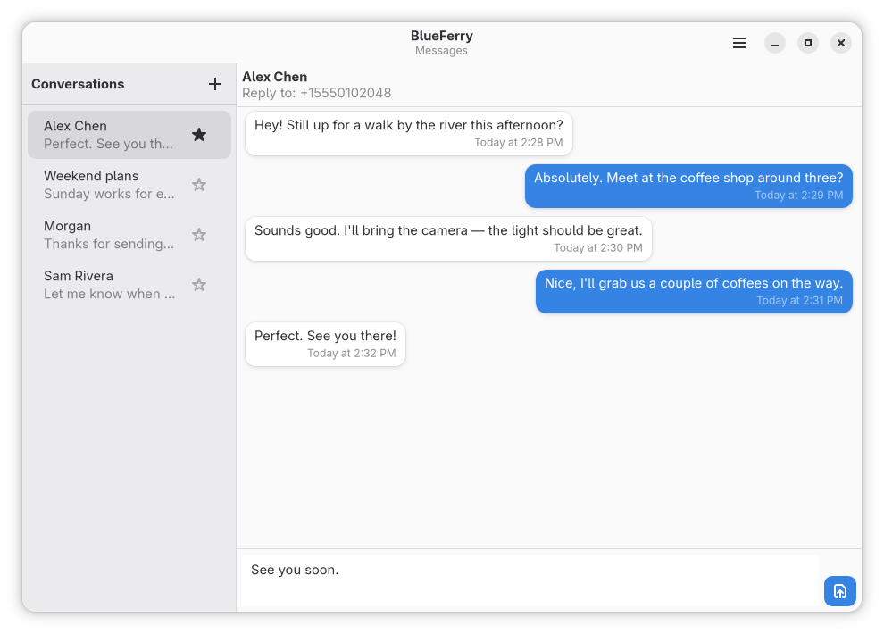
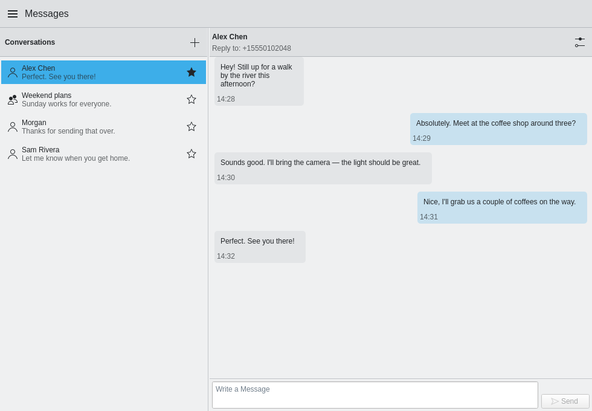
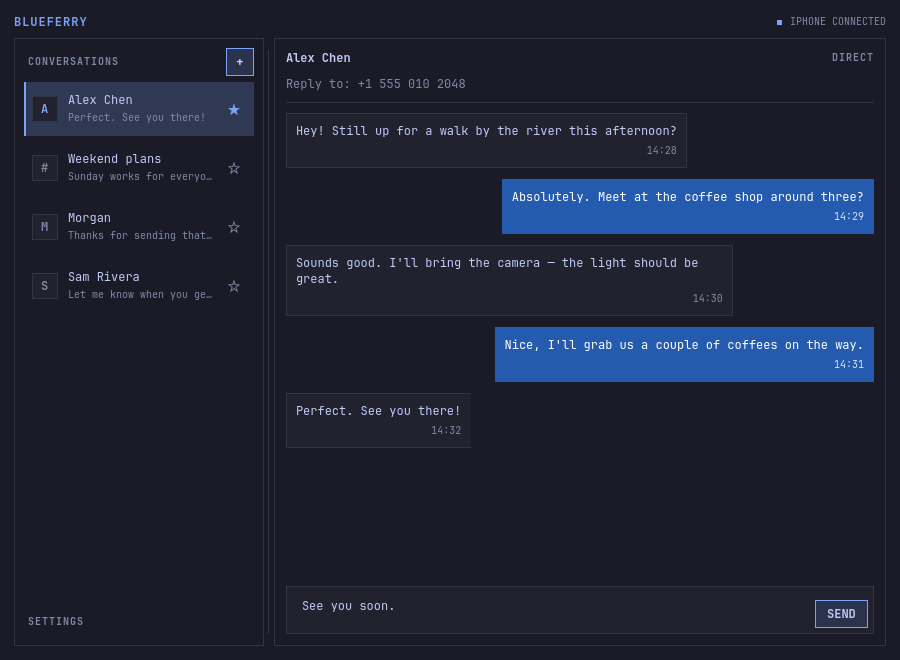
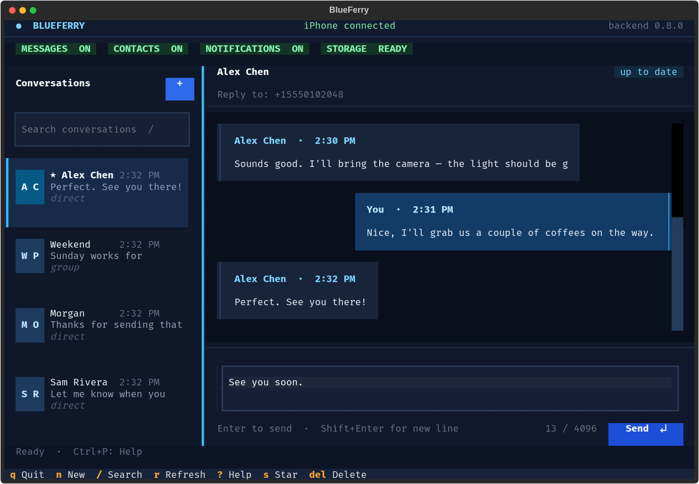

# Clients

Alle Clients sprechen mit demselben Hintergrunddienst. Du kannst also
zwischen ihnen wechseln oder mehrere gleichzeitig nutzen. Nachrichten,
Kontakte und Einstellungen sind überall dieselben.

Die Clients selbst sind derzeit auf Englisch.

## GTK (GNOME und ähnliche)

`blueferry-gtk` ist eine GTK4/libadwaita-App für GNOME, Cinnamon und ähnliche
Desktops.



Das Fenster ist eine Telefon-Übersicht. Eine Karte über den Reitern zeigt
Name und Verbindung des iPhones, Akku, Empfang und Netz sowie, was gerade
läuft (mit zurück, Wiedergabe/Pause und weiter). Ihr Knopf **Quick
Settings** enthält die Schalter für [den Ton](phone-audio.md) und die
[Abwesenheitssperre](proximity-lock.md). Ist etwas ausgeschaltet, nennt die
Karte die Einstellung, die es einschaltet. Die Reiter wechselt man
in der Kopfzeile, in einem schmalen Fenster unten:

- **Messages**: Unterhaltungen und der Chat.
- **Calls**: laufende [Anrufe](calls.md) mit annehmen, halten/fortsetzen
  und auflegen sowie dem Ton-Schalter, ein Wählfeld, das auch deine
  Kontakte nach Namen durchsucht, und die [Anrufliste](call-history.md) nach Tagen
  gruppiert, mit All und Missed, Rückruf- und Nachrichtenknöpfen und
  **Refresh from iPhone**. Jeder Anruf fragt vorher nach.
- **Notifications**: die [letzten iPhone-Mitteilungen](notification-history.md)
  anderer Apps. Ist die Liste aus, sagt der Reiter warum und öffnet die
  Einstellung.
- **Photos**: die neuesten Fotos und Videos eines [Foto-Plugins](plugins.md),
  mit All, Photos und Videos; ein Klick lädt das Original und öffnet es,
  ein geöffnetes lässt sich in andere Apps ziehen.

**Plugins & Tools** auf der Karte klappt auf, was der KDE-Client unter
seinen Schaltern zeigt: **From Plugins** (was [Plugins](plugins.md)
anbieten, mit ihren Knöpfen, und **Send to…**; auf ein Geräte-Element
gezogene Dateien gehen an dieses Gerät) und **Tools** (Bildschirm spiegeln,
LocalSend, die Fotos des iPhones über USB). Der Bereich bleibt, wie du ihn
verlassen hast, und klappt von selbst auf, wenn ein Plugin etwas Neues
bringt, etwa eine laufende Übertragung.

**Settings** (Hauptmenü, `Strg+,`) hat dieselben Kategorien wie der
KDE-Client, je eine Seite; die Umschaltleiste sitzt in der Kopfzeile, in
einem schmalen Fenster unten, und der Suchknopf findet jede Einstellung:

| Kategorie | Inhalt |
| --- | --- |
| Phone | Kopplung, Verbindungszustand mit **Reconnect**, **Run Diagnostics** (dieselben Prüfungen wie `blueferry doctor`; der Bericht öffnet sich in einem eigenen Dialog mit Kopierknopf), Kopplungsbericht, Kontaktabgleich, Kontaktfotos |
| Notifications | Welche Ereignisse Popups erzeugen, nur Kontakte, Klickregeln, Mitteilungsinhalt, Aktionsknöpfe, Mitteilungen mit dem iPhone abgleichen, beim Wegklicken als gelesen markieren, letzte Mitteilungen behalten |
| Calls & Audio | Anrufe, Anrufliste, Akku-Warnung, [iPhone-Ton am Computer](phone-audio.md), Mediensteuerung |
| Security | Einmalcodes, Abwesenheitssperre, lokale Daten und ihre Verschlüsselung, Verlauf löschen |
| Plugins | Installierte [Plugins](plugins.md) mit Schalter, **Show Log**, **Check for Update** und **Remove**; der Store, eine eigene Git-URL und die Plugin-Listen. Jede Installation fragt vorher nach. Die **Settings** eines Plugins öffnen sich als eigene Seite |
| About | Version, Hintergrunddienst, About BlueFerry, Tastenkürzel, **Restart Service**, Beenden |

Die Schalter, die einen Neustart brauchen (unten), funktionieren wie im
KDE-Client: Solange eine Änderung auf den Neustart wartet, beginnt jede
Seite mit einem Hinweis und **Restart Service**.

## KDE Plasma (Kirigami)

`blueferry-qt` ist eine Kirigami-App für KDE Plasma. Unter Ubuntu 24.04,
Linux Mint 22.3 und Pop!_OS 24.04 gibt es sie nicht.



Das Fenster ist eine Telefon-Übersicht. Links zeigt eine Karte Name,
Verbindung, Akku und Empfang des iPhones, was gerade läuft (mit zurück,
Wiedergabe/Pause und weiter) und Schnellschalter für [den
Ton](phone-audio.md) und die [Abwesenheitssperre](proximity-lock.md).
Ausgeschaltete Funktionen bleiben sichtbar, aber ausgegraut, mit der
Einstellung, die sie einschaltet. Rechts gibt es drei Reiter:

- **Messages**: Unterhaltungen mit den Filtern All, Unread und Starred und
  der Chat.
- **Calls**: [Anrufe](calls.md) mit Wählfeld und laufenden Anrufen als
  Karten (annehmen, halten, auflegen) und die [Anrufliste](call-history.md)
  nach Tagen gruppiert, mit All und Missed.
- **Notifications**: die [letzten iPhone-Mitteilungen](notification-history.md)
  anderer Apps.

In einem schmalen Fenster klappt die Karte hinter den Telefon-Knopf in der
Kopfzeile.

**Settings** (das Zahnrad in der Kopfzeile) hat links Kategorien, wie KDEs
Systemeinstellungen:

| Kategorie | Inhalt |
| --- | --- |
| Phone | Kopplung, Verbindungszustand, **Run Diagnostics** (dieselben Prüfungen wie `blueferry doctor`, im Fenster angezeigt), Kontaktabgleich, Kontaktfotos |
| Notifications | Welche Ereignisse Popups erzeugen, nur Kontakte, Klickregeln, Mitteilungsinhalt, Aktionsknöpfe, Mitteilungen mit dem iPhone abgleichen, beim Wegklicken als gelesen markieren |
| Calls & Audio | Anrufe, Anrufliste, Akku-Warnung, [iPhone-Ton am Computer](phone-audio.md), Mediensteuerung |
| Security | Einmalcodes, Abwesenheitssperre, lokale Daten und ihre Verschlüsselung, Verlauf löschen |
| About | Version, Hintergrunddienst, Tastenkürzel, Beenden |

In einem schmalen Fenster werden die Kategorien zur Liste; eine Kategorie
öffnet sich einzeln, **All Settings** führt zurück.

### Schalter, die einen Neustart brauchen

Einige Ein/Aus-Einstellungen brauchten bisher eine Änderung in
`~/.config/blueferry/local.env`: Mitteilungsinhalt anzeigen und eine Nachricht
beim Wegklicken des Popups als gelesen markieren. Die Einstellungsseite und `blueferry features` speichern sie
jetzt in `~/.config/blueferry/settings.json`, wo sie `local.env`
überschreiben. Sie gelten nach einem Neustart des Hintergrunddienstes; die
Seite sagt das und bietet **Restart Service** an. Eine Variable aus der
Umgebung des Dienstes gewinnt weiterhin, der Schalter sagt dann das.

```bash
blueferry features                                 # alle Schalter mit Wert und Quelle
blueferry features off mark_read_on_dismiss        # gilt nach einem Neustart
```

### Symbol im Systemabschnitt der Kontrollleiste

`blueferry-tray` kommt mit `blueferry-qt` und legt ein Telefon-Symbol in den
Systemabschnitt der Kontrollleiste (unter KDE Plasma ein
StatusNotifierItem). Das Symbol zeigt die Zahl der ungelesenen Nachrichten,
der Tooltip die Verbindung, den Akku, den Empfang und das Netz. Ein Klick
öffnet BlueFerry oder holt ein offenes Fenster nach vorne.

Starte es im Anwendungsmenü als **BlueFerry Tray**. Beim Anmelden startet es
nur, wenn du das willst: Hake im Menü des Symbols **Start at login** an, oder
führe aus:

```bash
blueferry-tray --autostart on     # off oder status
```

Das legt `~/.config/autostart/io.weirdware.BlueFerry.Tray.desktop` an, also
dieselbe Datei, die auch die Autostart-Einstellungen des Desktops anzeigen.

Das Symbol folgt nur einem laufenden Hintergrunddienst und startet ihn nie
selbst. Ohne eingerichtetes BlueFerry bleibt es ausgeblendet. Solange es
läuft, verzichtet `blueferry-qt` auf sein eigenes Symbol und beendet sich,
wenn du sein Fenster schließt; das Symbol öffnet es wieder.

## Quickshell

`blueferry-quickshell` übernimmt die aktive Farbpalette und die
Monospace-Systemschrift von Omarchy, mit kompakten Bedienelementen und
dünnen Rahmen. Gesendete Nachrichten bleiben in jedem Theme blau. Außerhalb
von Omarchy nutzt der Client die Desktop-Palette. Pakete gibt es für
Arch-basierte Distributionen.



Unter Omarchy Quattro zeigt das Leisten-Widget
[omarchy-blueferry](https://github.com/erikwb/omarchy-blueferry) den
Verbindungsstatus und ungelesene Unterhaltungen, jeweils mit einem
Antwortfeld:

```bash
omarchy plugin add https://github.com/erikwb/omarchy-blueferry.git
```

Aktiviere es unter **Setup → Plugins** und füge es deiner Leiste hinzu.
Kopplung, Nachrichten und Einstellungen erledigt weiterhin der vollständige
Quickshell-Client.

## Terminal (TUI)

Der Terminal-Client ist auf jeder Distribution Teil von `blueferry-backend`.

```bash
blueferry-tui
# oder
blueferry tui
```

`?` zeigt die Tastenbelegung, `Strg+P` die Befehlspalette. Der Client hat eine
Suche in Unterhaltungen, ein mehrzeiliges Eingabefeld, Mausunterstützung,
Themes und ein Layout, das sich schmalen Terminals anpasst.



## Kommandozeile

Der Befehl `blueferry` hilft bei der Diagnose und in Skripten:

```bash
blueferry doctor                     # Voraussetzungen prüfen
blueferry sms-list                   # letzte Nachrichten (--source local für den Cache)
blueferry sms-send '+41791234567' 'bin unterwegs'
blueferry sms-send person@icloud.com 'Hallo von Linux'
blueferry sms-send Alice 'komme später'
blueferry contacts-sync              # Kontakte neu vom iPhone holen
blueferry storage-policy-set encrypted   # oder plaintext, none
blueferry storage-unlock             # Schlüsselbund zum Entsperren auffordern
blueferry history-clear              # lokalen Nachrichtenverlauf löschen
blueferry pairing-issue              # GitHub-Issue mit dem letzten Kopplungsbericht öffnen
blueferry version
```

Ist ein Kontaktname mehrdeutig, listet BlueFerry die Treffer zur Auswahl auf,
statt zu raten. `blueferry <befehl> --help` zeigt alle Optionen.

## Welcher Client sich bei einer Mitteilung öffnet

Ein Klick auf eine Nachrichtenmitteilung öffnet die Unterhaltung in einem
laufenden grafischen Client, bevorzugt in dem zuletzt benutzten. Läuft keiner,
öffnet BlueFerry den zuletzt benutzten Client. Ohne frühere Wahl bevorzugt es
GTK unter GNOME, Qt unter KDE und Quickshell unter Omarchy/Hyprland und
weicht auf einen installierten Client aus.
