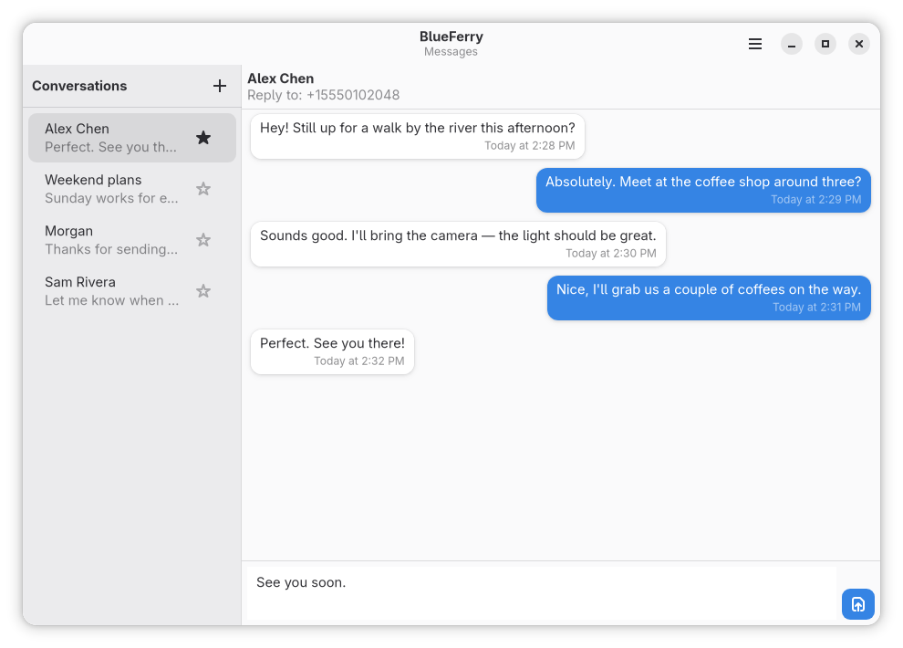
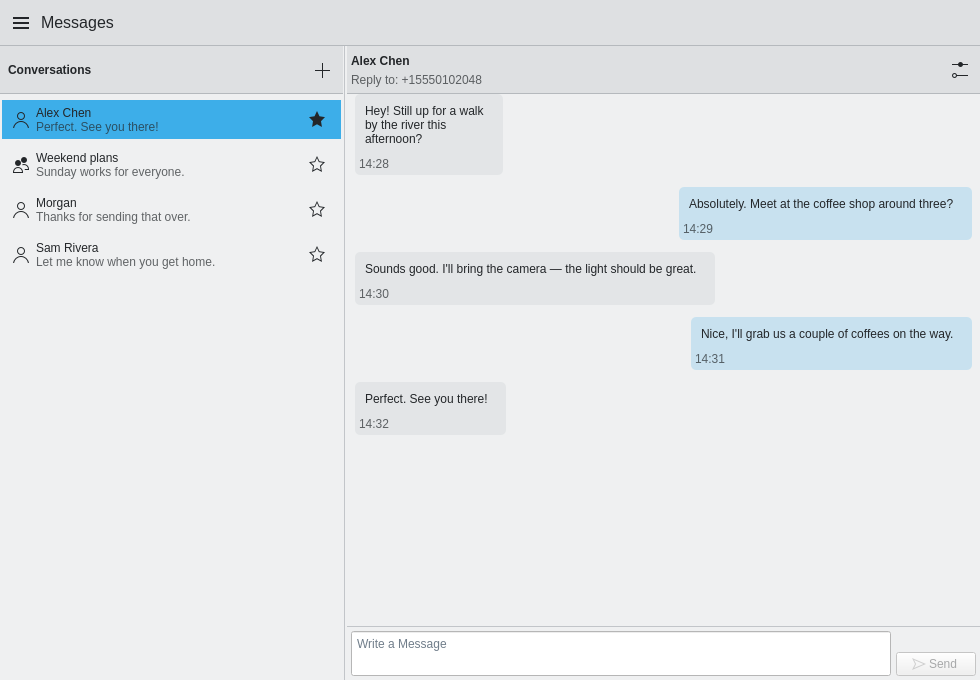
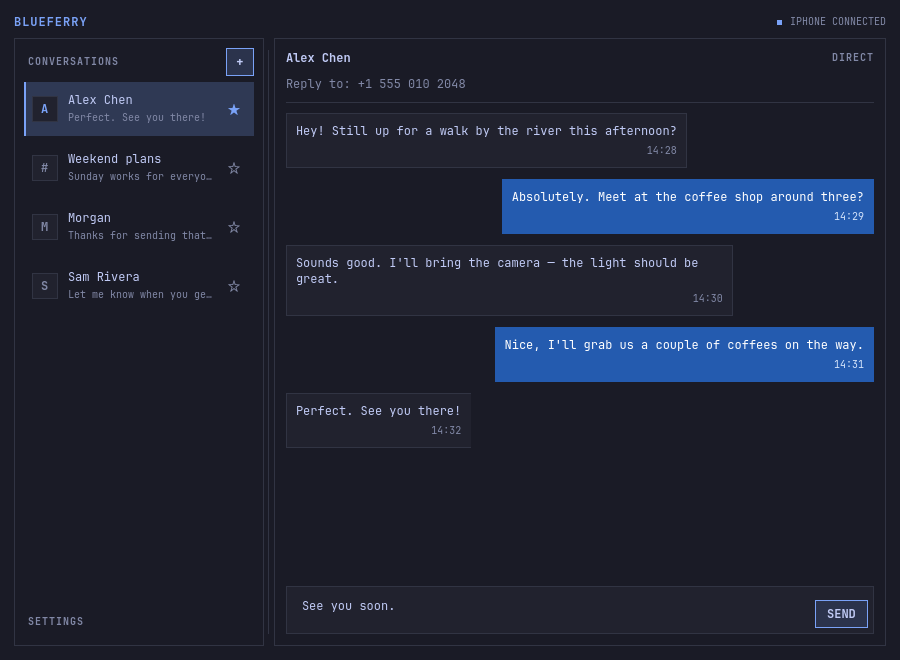
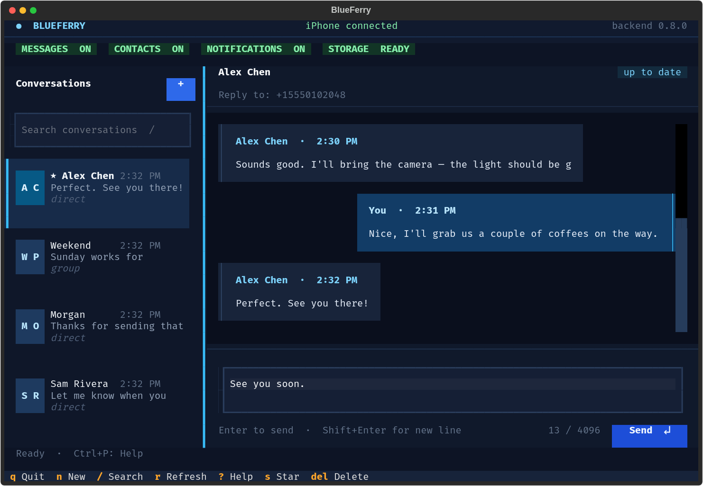

# Clients

All clients talk to the same background service, so you can switch between
them or run several at once. Messages, contacts, and settings are shared.

## GTK (GNOME and similar)

`blueferry-gtk` is a GTK4/libadwaita app for GNOME, Cinnamon, and similar
desktops.



The window is a phone overview. A card above the tabs shows the iPhone's
name and connection, battery, signal and network, and what is playing (with
previous, play/pause and next, and [volume down and up](media-control.md#volume)
around the level the iPhone last reported). Its **Quick Settings** button holds the
switches for [the sound](phone-audio.md) and the
[away lock](proximity-lock.md). When something is off, the card says which
setting turns it on. The tabs are switched in the header bar, or at the
bottom in a narrow window:

- **Messages**: conversations and the chat.
- **Contacts**: the [contact cards](contacts.md) with a search field; a
  card shows every number with its label, email and postal addresses,
  company, job title and photo, with **Call** and **Message** (opens the
  conversation with that number, or a new message).
- **Calls**: running [phone calls](calls.md) with answer, hold/resume,
  hang up, keypad tones (0-9, `*`, `#`) for the active call and the sound
  switch, a dial pad that also searches your
  contacts by name, and the [call history](call-history.md) grouped by day,
  with All and Missed, call back and message buttons, and **Refresh from
  iPhone**. Every call asks for confirmation first.
- **Notifications**: the [recent iPhone notifications](notification-history.md)
  of other apps, with a pin button on each entry; pinned entries are listed
  first, and entries removed on the iPhone or from
  [muted apps](notification-mute.md) are dimmed. When the list is off, the
  tab says why and opens the setting.
- **Photos**: the newest photos and videos of a [photo plugin](plugins.md),
  with All, Photos and Videos; a click downloads the original and opens it,
  and an opened one can be dragged into other apps.

**Plugins & Tools** on the card unfolds what the KDE client shows below
its switches: **From Plugins** (the items [plugins](plugins.md) offer, with
their buttons, and **Send to…**; files dropped on a device item are sent to
it) and **Tools** (screen mirroring, LocalSend, the iPhone's photos over
USB). It stays as you left it and unfolds by itself when a plugin brings
something new, such as a running transfer.

Drag files from the file manager anywhere onto the window to send them to
the iPhone through a **Send to…** plugin such as LocalSend; see
[dropping files on the window](plugins.md#dropping-files-on-the-window).

The magnifier in the header bar, `Ctrl+K` or `Ctrl+F` opens the
[search](search.md) over conversations, messages, contacts and calls.
Choosing a hit opens the conversation at that message, the contact card,
or the call in the call history.

**Settings** (main menu, `Ctrl+,`) has the same categories as the KDE
client, one page each; the switcher sits in the header bar, or at the
bottom in a narrow window, and the search button finds any setting:

| Category | What's there |
| --- | --- |
| Phone | Pairing, connection health with **Reconnect**, **Run Diagnostics** (the same checks as `blueferry doctor`; the report opens in its own dialog with a copy button), pairing report, contact sync, contact photos |
| Notifications | Which events create popups, contacts only, [muted apps](notification-mute.md), click rules, notification content, action buttons, sync notifications with iPhone, mark read on dismiss, keeping recent notifications |
| Calls & Audio | Phone calls, call history, battery warning, [iPhone sound on this computer](phone-audio.md), media control |
| Network | Opt-in [Bluetooth tethering](bluetooth-tethering.md) |
| Security | One-time codes, away lock, local storage and its encryption, Clear History |
| Plugins | Installed [plugins](plugins.md) with their switch, **Show Log**, **Check for Update** and **Remove**; the store, your own Git URL and the plugin lists. Every install asks first. A plugin's **Settings** open as a page of their own |
| About | Version, the background service, About BlueFerry, keyboard shortcuts, **Restart Service**, Quit |

The switches that need a restart (below) work as in the KDE client: while a
change waits for the restart, every page starts with a notice and
**Restart Service**.

## KDE Plasma (Kirigami)

`blueferry-qt` is a Kirigami app for KDE Plasma. It isn't available on
Ubuntu 24.04, Linux Mint 22.3, or Pop!_OS 24.04.



The window is a phone overview. On the left, a card shows the iPhone's name,
connection, battery and signal, what is playing (with previous, play/pause
and next), and quick switches for [the sound](phone-audio.md) and the
[away lock](proximity-lock.md). Features that are off stay visible but
greyed out, with the setting that turns them on. On the right are the
tabs:

- **Messages**: conversations with All, Unread and Starred filters, and the
  chat.
- **Contacts**: the [contact cards](contacts.md) with a search field; a
  card shows every number with its label, email and postal addresses,
  company, job title and photo, with **Call** and **Message** (opens the
  conversation with that number, or a new message).
- **Calls**: [phone calls](calls.md) with a dial pad and running calls as
  cards (answer, hold, hang up, keypad tones for the active call), and the [call history](call-history.md)
  grouped by day, with All and Missed. Dialing asks you to confirm the number;
  names and numbers with extensions are never converted into another number.
- **Notifications**: the [recent iPhone notifications](notification-history.md)
  of other apps.

In a narrow window the card folds behind the phone button in the header.
Messages are marked read only while their conversation is visible and the
window has focus. The phone card's sound switch controls media playback;
it does not switch the audio of a phone call.

Drag files from the file manager anywhere onto the window to send them to
the iPhone through a **Send to…** plugin such as LocalSend; see
[dropping files on the window](plugins.md#dropping-files-on-the-window).

The magnifier in the header, `Ctrl+K` or `Ctrl+F` opens the
[search](search.md) over conversations, messages, contacts and calls.
Choosing a hit opens the conversation at that message, the contact card,
or the call in the call history.

**Settings** (the gear in the header) has categories on the left, like KDE's
System Settings:

| Category | What's there |
| --- | --- |
| Phone | Pairing, connection health, **Run Diagnostics** (the same checks as `blueferry doctor`, shown in the window), contact sync, contact photos |
| Notifications | Which events create popups, contacts only, click rules, notification content, action buttons, sync notifications with iPhone, mark read on dismiss, muted apps |
| Calls & Audio | Phone calls, call history, battery warning, [iPhone sound on this computer](phone-audio.md), media control |
| Network | [Bluetooth tethering](bluetooth-tethering.md), share iPhone Internet, automatic hotspot connection |
| Security | One-time codes, away lock, local storage and its encryption, Clear History |
| About | Version, the background service, keyboard shortcuts, Quit |

In a narrow window the categories become a list; a category opens on its
own with **All Settings** to go back.

### Switches that need a restart

A few on/off settings used to need an edit of `~/.config/blueferry/local.env`:
showing notification content and marking a message read when you dismiss
its popup. The settings page and
`blueferry features` now store them in `~/.config/blueferry/settings.json`,
where they override `local.env`. They apply after the background service
restarts; the page says so and offers **Restart Service**. A variable set in
the service's own environment still wins, and the switch then says so.

```bash
blueferry features                                 # every switch, its value and source
blueferry features off mark_read_on_dismiss        # applies after a restart
```

### System tray item

`blueferry-tray` comes with `blueferry-qt` and puts a phone in the system
tray (a StatusNotifierItem on KDE Plasma). The icon shows the number of
unread messages; the tooltip shows the connection, battery, signal, and
network. Click it to open BlueFerry, or to bring an open window to the front.
It opens the client you use: a running BlueFerry window first, otherwise the
client you used last, otherwise the one that suits your desktop.

Start it from the application menu as **BlueFerry Tray**. It does not start
at login unless you ask for that: check **Start at login** in its menu, or
run:

```bash
blueferry-tray --autostart on     # off, or status
```

This writes `~/.config/autostart/io.weirdware.BlueFerry.Tray.desktop`, the
same file the desktop's own autostart settings show.

The tray only follows a running background service; it never starts it.
Without a BlueFerry setup the icon stays hidden. While the tray runs,
`blueferry-qt` leaves out its own tray icon and quits when you close its
window; the tray opens it again. **Quit Tray Icon** in its menu only removes
the tray icon; BlueFerry and its open windows keep running.

## Quickshell

`blueferry-quickshell` follows Omarchy's active palette and system monospace
font, with compact controls and thin frames. Sent message bubbles stay blue
across themes. Outside Omarchy, it uses the desktop palette. It's packaged
for Arch-based distributions.



On Omarchy Quattro, the
[omarchy-blueferry](https://github.com/erikwb/omarchy-blueferry) bar widget
shows connection status and unread conversations, with a reply field under
each one:

```bash
omarchy plugin add https://github.com/erikwb/omarchy-blueferry.git
```

Enable it in **Setup → Plugins** and add it to your bar. The full Quickshell
client still handles pairing, messages, and preferences.

### Settings

**iPhone settings** has the same categories as the Qt, GTK and terminal
settings, one below the other. A setting appears only when the running
background service offers it.

| Category | What you find there |
|---|---|
| Phone | Pairing, connection health with **Reconnect**, resetting a stuck connection automatically, **Run Diagnostics**, **Sync Contacts**, contact photos |
| Notifications | Which events create popups, contacts only, muted apps, notification content, action buttons, sync notifications with iPhone, mark read on dismiss, keeping recent iPhone notifications, and the recent notifications themselves with **Pin** / **Unpin** |
| Calls & Audio | Phone calls with their speaker and microphone and the replies for declining a call, call history and missed-call popups, battery warning, iPhone sound on this computer, media control and MPRIS |
| Security | One-time codes, away lock, the local storage setting, and **Reset Local Storage…** when the saved data can't be opened |
| About | The background service, its version and **Restart Service** |

The switches that need a restart show the restart notice at the top of the
page with **Restart Service**. A service that predates them shows each
switch greyed out with the `local.env` variable to set instead.

**Show Recent Notifications** lists the last 30 notifications that **Keep
recent iPhone notifications** keeps: the app, the time and, if allowed,
title and text. The list is read only while it is shown, follows new
notifications, and is forgotten when you hide it or leave the page. When it
is off, empty or unavailable, it says why. **Pin** / **Unpin** on an entry
keeps it in the list, also across restarts; pinned entries come first and
are marked **Pinned**. Entries removed on the iPhone say **Removed on
iPhone**; they and entries from muted apps are greyed out. At 20 pins only
**Unpin** stays available and the list says so.

**Muted apps** (under Notifications, with a background service that can mute
apps) lists the iPhone apps seen since the service started, each with
**Mute** / **Unmute**. A muted app shows no desktop popup; nothing changes on
the iPhone. The list follows changes made elsewhere, for example with
`blueferry notifications mute`.

While something is playing, the now-playing strip under the header also has
volume down and up buttons and the level the iPhone last reported. Each press
moves the iPhone volume one step; the buttons are greyed out when the playing
app does not offer volume control.

| | Qt | GTK | TUI | Quickshell | CLI |
|---|---|---|---|---|---|
| iPhone volume buttons and level | ✓ phone card, Now Playing | ✓ phone card | ✓ `-` / `+`, iPhone Overview | ✓ now-playing strip | ✓ `blueferry media volume up\|down` |
| Pin / unpin notifications | ✓ Notifications tab | ✓ Notifications tab | ✓ iPhone Notifications, `P` | ✓ Show Recent Notifications | ✓ `blueferry notifications pin\|unpin KEY` |
| Mute apps | ✓ Settings › Notifications | ✓ Settings › Notifications | ✓ Settings › Notifications › Muted apps | ✓ iPhone settings › Notifications | ✓ `blueferry notifications apps\|mute\|unmute` |

**From Plugins** under the now-playing strip shows what your
[plugins](plugins.md) offer while the conversations are shown, for example
AirPods or the next calendar entry, with their buttons; ↻ reads them again.
A plugin that fails shows a dimmed line. Buttons that send files (such as
**Send files…** on a LocalSend device) are left out, since the panel has
no file picker; a note under the section says where to find them. The
cards are not read while the panel is hidden.

The panel's notification list has no other row actions (it does not open or
answer notifications), so a notification the iPhone can no longer act on
looks the same there apart from **Removed on iPhone**.

### Contacts and search in the panel

The search button (⌕) next to **+**, or `Ctrl+F`, opens **Search** with a
background service that has [contact cards](contacts.md) or the [global
search](search.md). With an empty field it lists the contacts, with
**More contacts** for the next page. Typing at least two characters
searches conversations, messages, contacts and calls at once, a moment
after you stop typing; the hits are grouped and the matching words of a
message are shown in bold. Click a conversation or message to open it.
Click a contact to see its numbers, email and postal addresses: **Call**
calls a number after a confirmation, **Message** opens **New message** with
the number or address filled in. A call hit has **Call** and **Message**
for the caller. **Call** is greyed out, with the reason, until phone calls
are on and ready. The panel has no calls view, so answer, hold and hang up
on the iPhone or in another client. Nothing of this is read while the
popup is closed, and it is forgotten when you close it.

### What the panel leaves out

Quickshell is a compact panel, so some parts stay with the other clients:

| Left out | Why | Use instead |
|---|---|---|
| Plugin management and plugin settings | Each plugin brings its own settings form, secrets, buttons and log, and the store lists plugins to install; that is too much, and too varied, for a compact panel | Qt, GTK or terminal settings, `blueferry plugins` |
| **Send to…**, card buttons that send files, and the **Photos** tab (plugin features) | Sending needs a file picker or file drop, which the panel does not have; photos need a grid of thumbnails, too large for the panel | Qt or GTK client (Photos with thumbnails, Send to), terminal client, `blueferry send`, `blueferry photos` |
| Companion tools | Setting up desktop helpers is a one-time job, not a panel task | Qt or GTK settings, `blueferry tools` |
| Clearing the message history | Not offered by the terminal client either | `blueferry history-clear` |
| Click Rules, recent calls, the calls panel (and with it switching a running call to another speaker or microphone) | Not in the Quickshell client yet | Qt, GTK or terminal client, `blueferry calls audio … --this-call` |
| Muting this computer during a call | Needs the calls panel, which the panel does not have | Qt, GTK or terminal client, `blueferry calls mute on` / `off` |
| Declining a ringing call with a message | Needs the calls panel; the saved replies are edited in the panel's settings | Qt, GTK or terminal client, the reply button on the ringing call's popup (comes with the ringing popup of #230), `blueferry calls decline-with-message` |
| Contact photos, copying card entries, writing an email (mail app), opening a call hit in the recent calls | The panel's search only finds a contact to call or write; it has no recent-calls list | `blueferry contacts show --photo`; recent calls in the Qt, GTK or terminal client |

The panel loads no translation catalog, so its own labels are English.
Texts that come from the shared BlueFerry code, such as the reconnect hint,
the restart notice, the notification placeholder, the pin and mute texts,
the volume level or the checks for saved replies, follow your language.

## Terminal (TUI)

The terminal client is part of `blueferry-backend` on every distribution.

```bash
blueferry-tui
# or
blueferry tui
```

Press `?` for the keyboard map or `Ctrl+P` for the command palette. It has
conversation search, a multiline composer, mouse support, themes, and a layout
that adapts to narrow terminals.



### Settings

`o` opens **Settings**, with the same categories as the Qt and GTK settings as
tabs. A setting appears only when the running background service offers it.

| Category | What you find there |
|---|---|
| Phone | Background service state, **Reconnect** (also `b`), resetting a stuck connection automatically (also `B`), **Run Diagnostics**, contact sync, contact photos |
| Notifications | Which events create popups, contacts only, **Click Rules** (also `l`), [muted apps](notification-mute.md), notification content, action buttons, sync notifications with iPhone, mark read on dismiss, keeping recent iPhone notifications |
| Calls & Audio | Phone calls, call history and missed-call popups, battery warning, iPhone sound on this computer (also `a`), media control and MPRIS |
| Security | One-time codes, away lock, the local storage setting (shown; change it with `blueferry storage-policy-set`) |
| Plugins | Installed [plugins](plugins.md) (Space on/off, Enter **Settings**, `u` update, Delete remove, `g` the log in the terminal), the plugin lists with install and update, your own Git URL and the lists themselves. Every install asks first. A plugin's **Settings** open as a form of their own |
| About | Version, the background service with **Restart Service**, the keyboard map |

The switches that need a restart (see above) show the restart notice at the
top of Settings with **Restart Service**. A service that predates them shows
each switch greyed out with the `local.env` variable to set instead.

**Run Diagnostics** runs `blueferry doctor` and shows its report. **Copy
Report** puts it on the clipboard through the terminal (OSC 52); where the
terminal does not pass that on, select the text with the mouse instead.

A plugin's settings form follows what the plugin asks for, like the Qt and
GTK forms: sections (folded ones open with **Show**), fields that appear only
for some choices, examples and help links, **Test Connection**, a browser
sign-in and the plugin's own buttons. **Save** (or `Ctrl+S`) becomes
available once the required fields are valid. A stored password or key is
never shown: its field stays empty and masked, and leaving it empty keeps it.

The command palette (`Ctrl+P`) also has **Settings: Phone** … **Settings:
About** and **Run Diagnostics**. Pairing stays with `blueferry pair-setup`
or a graphical client.

### iPhone, calls and notifications

**iPhone Overview** in the command palette is the terminal's phone card:
the iPhone's name, the connection, battery, signal and network, what is
playing, and for each optional feature that is off the switch that turns it
on and its Settings category. Under now playing, **Volume Down**,
**Play/Pause** and **Volume Up** control the iPhone without closing the
overview; anywhere outside a text field, `-` and `+` (or `=`, the same key
without Shift) step the volume too.
The volume moves one iPhone step at a time, and the level the iPhone last
reported is shown next to the title. Its other buttons open the
notification list, the recent calls, the calls panel and Settings.

Below, **From Plugins** lists what your [plugins](plugins.md) offer, for
example a calendar entry, AirPods or a LocalSend device, with their buttons;
Enter runs the highlighted one. **Send to…** asks for a target and the
paths of the files to send (→ completes a path). It is read only while the
overview is open. **Photos** in the palette (there while a photo plugin is
enabled) lists the newest items of that plugin; Enter opens one in your image viewer, `c` copies its path.

| | Qt | GTK | TUI | Quickshell | CLI |
|---|---|---|---|---|---|
| Plugin cards with their buttons | ✓ | ✓ | ✓ iPhone overview | ✓ From Plugins, without buttons that send files | ✓ `blueferry cards` |
| Plugin management and settings | ✓ | ✓ | ✓ Settings › Plugins | — | ✓ `blueferry plugins` |
| Send to… | ✓ | ✓ | ✓ file paths | — | ✓ `blueferry send` |
| Dropping files on the window or a card item | ✓ | ✓ | — a terminal gets no file drops | — | — |
| Photos | ✓ thumbnails | ✓ thumbnails | ✓ list without thumbnails | — | ✓ `blueferry photos` |
| Companion tools | ✓ | ✓ | — | — | ✓ `blueferry tools` |

**iPhone Notifications** (in the palette and the overview) lists the recent
iPhone app notifications that **Keep recent iPhone notifications** keeps:
the app, the time and, if allowed, title and text. It is read only while it
is open, follows new notifications, and is forgotten when you close it.
When the list is off, empty or unavailable, it says why; **Open
Notification Settings** goes to Settings › Notifications. `P` (or **Pin**)
pins or unpins the selected notification; pinned ones are listed first and
marked **Pinned**. Entries removed on the iPhone say **Removed on iPhone**
and are dimmed, and so are the entries of apps muted under Settings ›
Notifications › **Muted apps**, where each app has its own checkbox.

The calls panel (`c`, or **Phone Calls** in the palette) words each call
like Qt and GTK (incoming, on hold, the duration). Its one row of buttons
acts on the obvious call: **Answer** the ringing one, **Hold** or
**Resume** the connected one, **Hang Up** (or **Decline**) the active one
first; a call waiting while another is connected gets its own **Decline**.
During an active call, the keys 0-9, `*` and `#` are sent at once as
keypad tones, for example to a phone menu, unless a text field has the
focus; the panel shows them as "Sent: …". The keypad tone field sends a
whole sequence such as a PIN. Typing a name in the number field suggests the
phone numbers of matching contacts. A call is always confirmed first.

**Recent calls** (`h`) are grouped by day; `m` shows only missed calls and
`s` (or **Refresh from iPhone**) reads the iPhone's list again. Enter or
**Call Back** calls the selected number after the confirmation, **Send a
Message** starts a new message to it.

### Contacts and search

`C` (Shift+c; or **Contacts** in the palette) opens the iPhone's
[contact cards](contacts.md). The list follows the search field a moment
after you stop typing and loads further contacts when you reach its end.
Enter shows the selected card: name, job title and company, then every
number, email and postal address with its label. On a detail row, `c` (or
**Call**) calls the number after the confirmation, `m` (or **Send a
Message**) starts a new message to the number or email address, and `y` (or
**Copy**) copies the entry through the terminal (OSC 52). Enter does the
first of these the row offers. Contact photos and writing an email in a
mail app are not offered in the terminal; copy the address instead. When
the background service restarts or re-reads the contacts, the list and an
open card are read again; a card that changed meanwhile says so.

`f` (or **Search Everything** in the palette) is the [global
search](search.md): one field for conversations, messages, contacts and
calls, grouped, with the matching words of a message highlighted. It
searches a moment after you stop typing; Enter in the field moves to the
results. Enter on a hit opens it: the conversation (at the message), the
contact card, or **Recent calls** with that call selected. `/` stays the
quick filter of the conversation list.

## Command line

The `blueferry` command is useful for diagnostics and scripts:

```bash
blueferry doctor                     # check prerequisites
blueferry sms-list                   # recent messages (--source local for the cache)
blueferry sms-send '+15551234567' 'on my way'
blueferry sms-send person@icloud.com 'hello from Linux'
blueferry sms-send Alice 'running late'
blueferry contacts-sync              # pull contacts from the iPhone again
blueferry storage-policy-set encrypted   # or plaintext, none
blueferry storage-unlock             # ask the keyring to unlock stored data
blueferry storage-reset              # erase all local data and replace the key
blueferry history-clear              # delete local message history
blueferry pairing-issue              # open a GitHub issue with the last pairing report
blueferry version
```

If a contact name is ambiguous, BlueFerry lists the matches for you to choose
from instead of guessing. Run `blueferry <command> --help` for all options.

## Which client opens from a notification

Clicking a message notification opens its conversation in a running graphical
client, preferring the one you used most recently. If none is running,
BlueFerry opens the last client you used. Without a previous choice, it
prefers GTK on GNOME, Qt on KDE, and Quickshell on Omarchy/Hyprland, falling
back to whichever client is installed.
