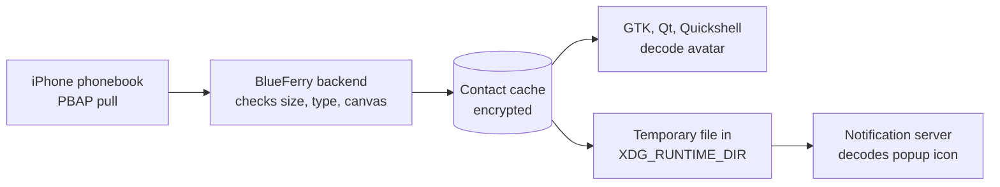

# Contact photos

BlueFerry can show the pictures from your iPhone's contacts as avatars in the
GTK, Qt (KDE), and Quickshell conversation lists and conversation headers,
and as the icon of desktop message popups. This is
**off by default**.

## How it works

The iPhone already sends contact photos in the normal contact download. Without
this option BlueFerry throws them away; with it, BlueFerry keeps them. There is
no second Bluetooth transfer.



The backend never decodes an image itself. It only checks that a photo is a
JPEG or PNG of at most 256 KiB and 2048×2048 pixels. Decoding happens in the
desktop clients and in your notification server.

## Turn it on

Tick **Show contact photos from the iPhone** in the iPhone settings of any
client:

| Client | Where |
| --- | --- |
| Qt (KDE) | iPhone settings, "Contact Photos" |
| GTK | iPhone page, "Contact Photos" |
| Quickshell | iPhone settings, "Contact photos" |
| Terminal (TUI) | press `o` for Options |
| CLI | `blueferry contact-photos enable` (`disable`, `status`) |

The backend saves the choice in `~/.config/blueferry/settings.json`,
applies it at once and starts a contact sync; the photos arrive with it.
No restart is needed.

Earlier versions used `BLUEFERRY_CONTACT_PHOTOS=true` in
`~/.config/blueferry/local.env`. That line still works as the starting
value until you change the setting in a client; from then on the saved
choice wins, and the log says so at startup.

Conversations with a known contact now show the photo. Groups and unknown
numbers keep the usual icon.

To save one photo to a file:

```bash
blueferry contacts-photo "Jane Doe" -o jane.jpg
```

The file is created with mode 0600 and is never overwritten without `--force`.

## Turn it off

Untick the checkbox (or run `blueferry contact-photos disable`). BlueFerry
deletes the avatar files at once and erases the stored photos right after
any contact sync that is still running. A backend that starts with the
option off erases leftovers too.

**Before going back to an older BlueFerry release**, turn the option off
first, so the photos are deleted right away. If you forget,
the older release deletes them together with the contacts at its next
contact sync or when the storage mode changes.

## Limits

- Only JPEG and PNG photos are kept. Photos given as a link are never
  downloaded.
- One photo per contact, at most 256 KiB each and 16 MiB per sync. When the
  per-sync budget runs out, later photos are skipped and the log says how
  many. For scale: one iPhone on iOS 27 sent 42 photos with 3730 contacts,
  all small thumbnails (2 to 19 KiB, about 5 KiB on average).
- A photo shows only when the address belongs to exactly one contact. A number
  shared by two contacts shows neither photo, and a contact whose every
  number is shared doesn't have its photo stored at all.
- GTK, Qt and Quickshell show photos for direct conversations. Groups keep
  their group icons, and a contact without a usable photo keeps its usual icon.
  The terminal client keeps its icons.
- Avatars load asynchronously and refresh after a contact sync. Turning photos
  off clears the clients' photo caches after they receive the updated status.
  Photo lookup failures do not interrupt messaging.
- Popup icons depend on the notification server honouring `image-path`.
  Plasma is expected to; this hasn't been tested yet. A server that ignores
  it shows the usual icon.

## Check what your iPhone sends

After each sync the backend logs one line with counts only, never a name,
number or picture:

```bash
journalctl --user -u blueferry | grep "with photos"
```

It shows how many photos fell into each size range (`<=16KiB` up to `>8MiB`,
so photos over the limit show how far over they are), the largest photo in
bytes (`max:`), and why photos were not kept (`too-large`, `dimensions`,
`format`, `not-inline`, `shared`, `budget`, `time`). The limits are based on
one iPhone; if many photos are `too-large` or `dimensions` on yours, please
report the line.

## Privacy

- With the option off, nothing is parsed, stored or served.
- Stored photos use the same encryption, storage mode and replacement as the
  contact cache, and are replaced on every sync.
- Photos never appear in logs or D-Bus signals. Clients fetch them through a
  rate-limited method.
- For popups, the backend writes a temporary owner-only copy with a random
  name to `$XDG_RUNTIME_DIR/blueferry`. When contacts change, the copies are
  no longer used for new popups but stay readable for popups already shown,
  until newer copies replace them (at most 64 files). All copies are deleted
  when the storage mode changes and when the backend stops.
- Your notification server receives the photo, just as it already receives
  the sender's name.
