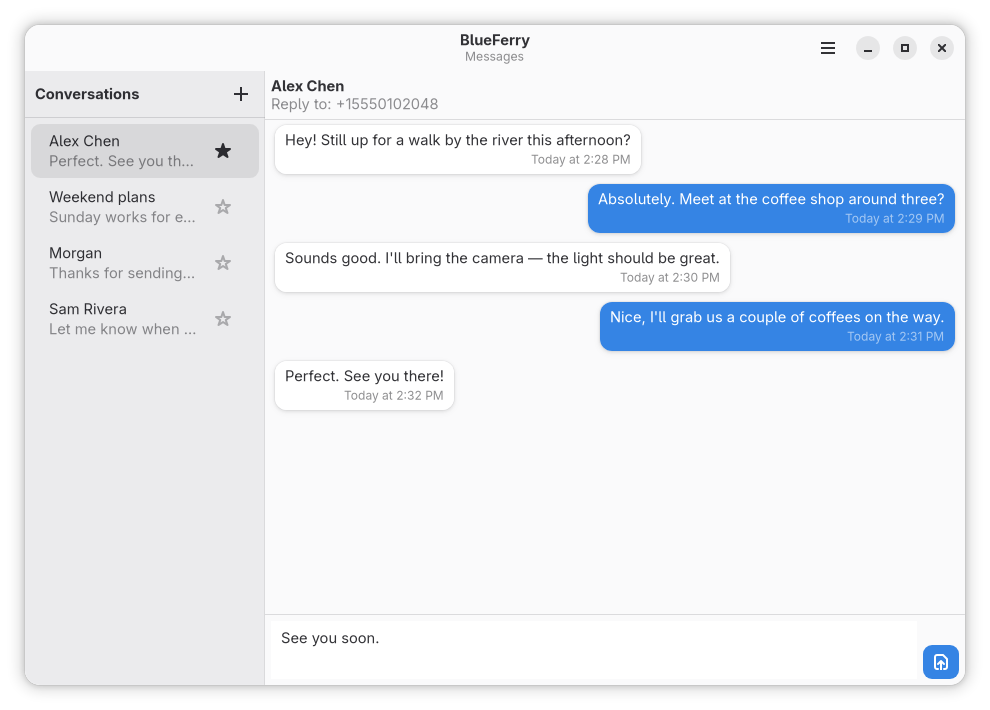

# Overview

BlueFerry connects your Linux computer directly to your iPhone using Bluetooth
profiles that iOS supports natively. One background service on the computer
holds the connection; the graphical and terminal clients show your
conversations.

## What works

- Receive and send SMS, RCS, and iMessage through the iPhone.
- Start a new conversation and search synced contacts.
- Sync contacts, including phone numbers and Apple ID email addresses.
- Mark messages read from the desktop.
- Show desktop notifications for messages and, optionally, for other iPhone
  apps.
- Group chats, when BlueFerry can identify the participants safely.
- Keep local history encrypted with GNOME Keyring or KDE Wallet.
- Use native GTK, KDE/Kirigami, Quickshell, or terminal clients.

## What doesn't work

These are limits of what iOS exposes over Bluetooth, not missing settings:

- BlueFerry only knows messages it sees while connected. It doesn't download
  your iCloud Messages archive or your complete sent-message history.
- Attachments, reactions, and typing indicators are not supported.
- Calls and FaceTime are not supported; calls and music stay on the iPhone.
- Bluetooth gives BlueFerry no reliable group ID or complete member list, so
  group replies are deliberately cautious (see [Group chats](#group-chats)).
- Notifications from other iPhone apps are display-only. You can't reply to
  them.

## How it connects

BlueFerry uses three standard Bluetooth services:

| Service | Bluetooth | Provides |
| --- | --- | --- |
| MAP (Message Access Profile) | Classic | Messages, read state, sending |
| PBAP (Phone Book Access Profile) | Classic | Contacts |
| ANCS (Apple Notification Center Service) | Low Energy | Optional notifications and group-message details |

Messages and contacts work without ANCS. ANCS adds the information BlueFerry
needs to recognize group messages and lets it mirror other app notifications.

## Requirements

- A Bluetooth adapter with Bluetooth Classic **and** Bluetooth 4.0 or newer
  with LE advertising. LE advertising is needed even for messages and
  contacts, because it makes the iPhone show their permission switches.
  Bluetooth 3-only adapters don't work.
- BlueZ 5.72 or newer for messages and contacts. iPhone system notifications
  (ANCS) need BlueZ 5.86 or newer.
- An iPhone. Most development used an iPhone 16 Pro Max on iOS 26.5, with
  additional successful tests on an iPhone 17 Pro Max with an iOS 27 beta.
  For iOS 18 or earlier, use compatibility pairing (see
  [Pair an iPhone](pairing.md#pairing-options)).

Support varies between adapters and iOS versions. Realtek adapters generally
don't support system notifications or group chats.

## Conversations

Direct conversations combine the phone numbers and email addresses that
belong unambiguously to one synced contact. Replies go to the most recent
incoming address, shown as **Reply to** above the conversation. Shared
addresses, and contacts that merely have the same name, stay separate.

## Group chats

Bluetooth doesn't tell BlueFerry a group's ID or full member list, so it
asks you who is in a group when it can't tell:

- For a named group, BlueFerry learns members only from the people who send to
  it.
- For an unnamed group, the iPhone names the members. BlueFerry fills in the
  addresses it can match, but you choose for anyone with more than one phone
  number or email, such as a number and an Apple ID.
- When you send to such a group, BlueFerry asks you to confirm its members
  first. It suggests contacts as you type and also accepts a phone number or
  email. Your message waits in the reply box until the list is saved.
- The saved list stays until you delete the conversation, clear history, or
  change the storage mode. It doesn't change the group on the iPhone.
- If someone who isn't on the saved list writes, BlueFerry stops replying
  until you review the list.
- BlueFerry recognizes an unnamed group by its members' names. If you rename a
  member in Contacts, or someone joins or leaves, the group becomes a new
  conversation and BlueFerry asks again.
- A message is filed under its group only when BlueFerry also receives the
  iPhone's notification for it. Without one, it appears in the sender's
  one-to-one conversation.

## Next steps

[Install BlueFerry](install.md), then [pair your iPhone](pairing.md).
